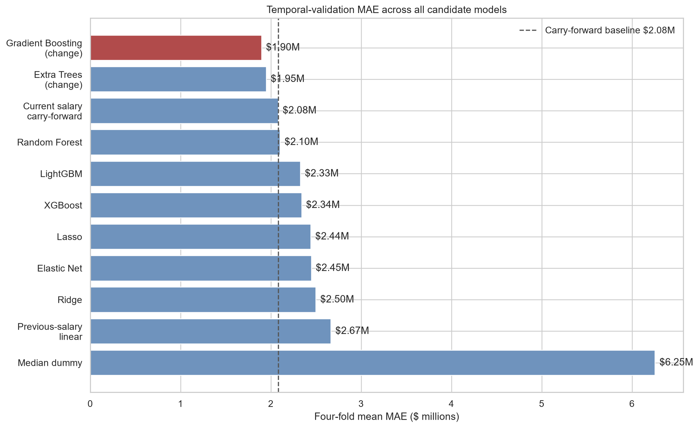
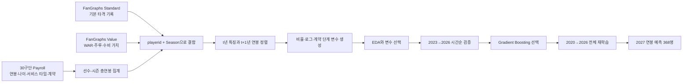
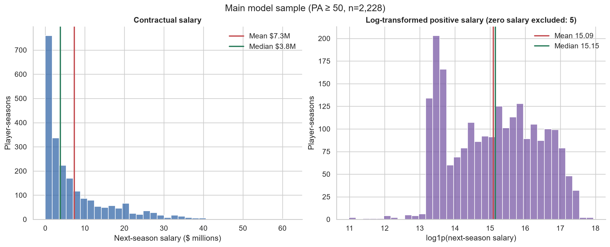
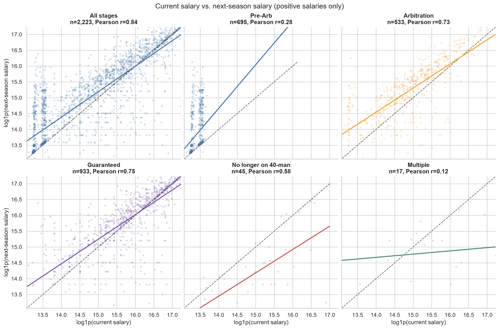
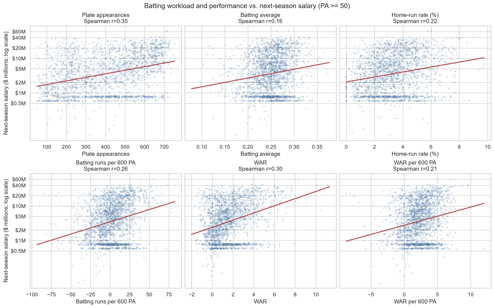
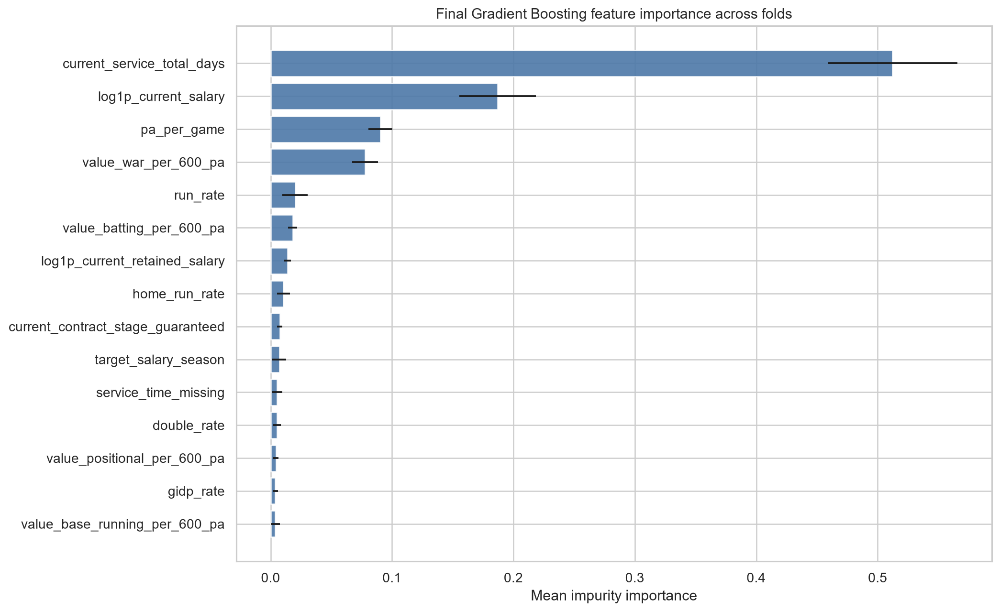

# MLB 타자 다음 시즌 연봉 예측

> 야구를 잘 모르는 사람도 **“어떤 데이터를 모아, 어떻게 다음 해 연봉을 예측했고, 그 결과를 어디까지 믿을 수 있는가?”**를 처음부터 끝까지 이해할 수 있도록 정리한 프로젝트 안내서입니다.

이 프로젝트는 MLB 타자의 한 시즌 성적, 나이, 메이저리그 경력, 현재 계약 상태와 현재 연봉을 이용해 **다음 시즌의 선수별 총연봉(미국 달러)**을 예측합니다. 예를 들어 2025년 정보로 2026년 연봉을 예측하는 과거 실험을 반복한 뒤, 최종적으로 2026년 7월 22일 시점의 부분 시즌 정보로 2027년 연봉을 예측합니다.

## 핵심 결과 먼저 보기

| 항목 | 결과 | 쉬운 해석 |
|---|---:|---|
| 최종 모델 | Gradient Boosting | 여러 개의 작은 의사결정 나무가 이전 나무의 실수를 차례로 보완하는 모델 |
| 예측 대상 | `log(다음 연봉) - log(현재 연봉)` | 연봉 액수 자체보다 현재 연봉에서 얼마나 오르거나 내릴지를 학습 |
| 시간순 검증 표본 | 1,280 선수-시즌 | 2023~2026년을 한 해씩 미래로 두고 평가한 전체 행 수 |
| 최종 모델 평균 MAE | **$1.90M** | 한 선수의 예측이 실제 연봉과 평균 약 190만 달러 차이 |
| 현재 연봉 그대로 사용한 기준선 MAE | $2.08M | “내년에도 올해와 같은 연봉”이라고 단순 예측한 결과 |
| 기준선 대비 개선 | **8.85%** | 최종 모델이 평균 절대오차를 약 18.4만 달러 줄임 |
| 연도별 기준선 승리 | **4/4개 연도** | 2023, 2024, 2025, 2026년 검증에서 모두 기준선보다 낮은 MAE |
| 최종 재학습 표본 | 2,228 선수-시즌 | 2020~2026년 연봉이 확인된 `PA >= 50` 타자 |
| 2027년 예측 대상 | 368명 | 2026년에 50타석 이상 기록하고 현재 연봉이 완전한 타자 |
| 2027년 예측 중앙값 | **$2.93M** | 368개 예측의 가운데 값. 실제 계약 확정액이 아님 |

가장 중요한 결론은 “복잡한 모델이 압도적으로 정확하다”가 아닙니다. MLB 연봉은 장기계약 때문에 전년도 연봉과 매우 비슷한 경우가 많아 **현재 연봉 자체가 강력한 기준선**입니다. 이 프로젝트의 최종 모델은 그 강한 기준선을 네 개의 미래 연도에서 일관되게 이겼지만, 고액 연봉 구간에서는 여전히 오차가 큽니다.



## 목차

- [1. 야구를 모르는 독자를 위한 최소 배경지식](#1-야구를-모르는-독자를-위한-최소-배경지식)
- [2. 문제 정의와 분석 단위](#2-문제-정의와-분석-단위)
- [3. 전체 파이프라인](#3-전체-파이프라인)
- [4. 데이터 출처와 프로젝트 구조](#4-데이터-출처와-프로젝트-구조)
- [5. Step 1 — 데이터 수집과 검증](#5-step-1--데이터-수집과-검증)
- [6. Step 2 — 데이터 전처리와 변수 생성](#6-step-2--데이터-전처리와-변수-생성)
- [7. Step 3 — 탐색적 데이터 분석](#7-step-3--탐색적-데이터-분석)
- [8. Step 4 — 모델 학습과 시간순 검증](#8-step-4--모델-학습과-시간순-검증)
- [9. 최종 모델과 2027년 예측](#9-최종-모델과-2027년-예측)
- [10. 실행 방법](#10-실행-방법)
- [11. 주요 파일 읽는 법](#11-주요-파일-읽는-법)
- [12. 한계와 올바른 해석](#12-한계와-올바른-해석)
- [13. 자주 묻는 질문](#13-자주-묻는-질문)

## 1. 야구를 모르는 독자를 위한 최소 배경지식

### 1.1 타자와 투수

야구 선수는 크게 공을 던지는 **투수**와 공을 치고 주루·수비를 하는 **야수/타자**로 나뉩니다. 이 프로젝트의 주 분석 대상은 타자입니다. FanGraphs의 포지션 값이 `P`인 투수는 제외하되, 투수와 타자를 겸하는 오타니 쇼헤이(`playerid=19755`)는 타자로 포함합니다.

### 1.2 자주 등장하는 기록

| 용어 | 뜻 | 이 프로젝트에서의 의미 |
|---|---|---|
| 경기 수 (`G`) | 선수가 출전한 경기 수 | 출전 기회의 크기 |
| 타석 (`PA`) | 타자가 타격을 완료한 기회의 수 | 표본 크기이자 출전량. 주 표본은 한 시즌 50타석 이상 |
| 타수 (`AB`) | 타석 중 볼넷·몸에 맞는 공 등 일부를 뺀 횟수 | 타율 계산의 분모 |
| 타율 (`AVG`) | 안타 ÷ 타수 | 얼마나 자주 안타를 쳤는지 나타내는 전통적 지표 |
| 홈런 (`HR`) | 타구 하나로 타자가 홈까지 들어오는 장타 | 장타력의 대표 지표 |
| 볼넷 (`BB`) | 공 네 개를 골라 1루로 나감 | 출루 능력의 일부 |
| 삼진 (`SO`) | 스트라이크 세 개로 아웃 | 타격 결과의 한 종류 |
| 도루 (`SB`) | 투구 중 다음 베이스로 진루 | 주루 능력의 일부 |
| WAR | 대체 가능한 선수보다 팀 승리에 얼마나 더 기여했는지 추정한 종합 지표 | 타격·주루·수비·포지션 가치를 합친 성과 변수 |

누적 홈런 20개와 10개를 그대로 비교하면 출전량 차이가 섞입니다. 그래서 모델은 `홈런 ÷ 타석` 같은 **타석당 비율**과 `600타석당 WAR` 같은 정규화 지표를 주로 사용합니다. 600타석은 풀타임 타자의 한 시즌 출전량을 직관적으로 표현하기 위한 공통 기준입니다.

### 1.3 연봉을 좌우하는 계약 단계

MLB 연봉은 경기 성적만으로 매년 새로 정해지지 않습니다. 선수의 메이저리그 경력과 이미 체결한 다년 계약이 매우 중요합니다.

| 프로젝트 표기 | 쉬운 설명 |
|---|---|
| `pre_arb` | 연봉조정 자격 전. 대체로 구단 통제력이 강하고 연봉이 낮은 초기 경력 단계 |
| `arbitration` | 선수와 구단이 연봉을 협상하고 필요하면 조정 절차를 이용할 수 있는 단계 |
| `guaranteed` | 다년 계약 등을 통해 해당 시즌 금액이 보장된 단계 |
| `no_longer_40man` | 40인 로스터에서 빠진 선수와 관련된 지급 항목 |
| `multiple` | 한 선수-시즌에 둘 이상의 계약 그룹이 동시에 관찰된 경우 |

`Service Time`은 선수가 MLB 로스터에서 보낸 기간입니다. 원본의 `연도.일수` 표기를 연도, 일수, 총일수로 나눠 사용합니다. 이것은 단순한 나이와 달리 선수의 계약상 경력 위치를 보여줍니다.

### 1.4 “연봉”의 정의

이 프로젝트의 목표값은 FanGraphs Payroll 표에서 확인한 **해당 시즌 선수별 지급 연봉의 합계**입니다.

- 같은 선수에게 여러 구단이 일부씩 지급하면 지급액을 합칩니다.
- 같은 금액이 중복 표기된 경우 한 번만 계산합니다.
- `TBD`, `Pre-Arb`, `MiLB`처럼 숫자가 아닌 상태값을 임의로 0달러로 바꾸지 않습니다.
- 계약 전체 평균인 `AAV`와 특정 시즌 실제 지급액인 `Salary`를 섞지 않습니다.
- 사치세 계산용 금액이나 선수 가치 평가액을 예측하는 프로젝트가 아닙니다.

## 2. 문제 정의와 분석 단위

### 2.1 한 문장으로 표현한 예측 문제

> 시즌 `t`까지 알 수 있는 타격·선수·현재 계약 정보를 이용해, 같은 선수의 시즌 `t+1` 총연봉을 예측한다.

한 행은 **한 선수의 한 시즌**, 즉 `playerid + Season` 조합입니다. 이름은 철자나 축약이 달라질 수 있으므로 결합 키로 사용하지 않고 FanGraphs의 고유 `playerid`를 사용합니다.

| 구분 | 시즌 예시 | 포함 정보 |
|---|---|---|
| 입력(Feature) | 2025 | 2025 성적, 나이, 서비스 타임, 계약 단계, 2025 연봉 |
| 목표(Target) | 2026 | 2026 시즌 총연봉 |
| 최종 예측 입력 | 2026 | 2026년 7월 22일 부분 시즌 성적과 2026 Payroll |
| 최종 예측 목표 | 2027 | 아직 관측되지 않은 2027 총연봉 |

수식으로 쓰면 다음과 같습니다.

```text
X(선수, t년)  ──모델──>  Salary(같은 선수, t+1년)
```

### 2.2 분석 범위

- 대상 리그: MLB
- 대상 선수: 투수를 제외한 타자, 오타니 쇼헤이는 타자로 포함
- 성적 수집 기간: 2018~2026
- Payroll 수집 기간: 2019~2026, 30개 구단 × 8시즌 = 240파일
- 주 학습 표본: 입력 시즌 `PA >= 50`, 완전한 현재·다음 시즌 연봉이 있는 행
- 모델 선택용 목표 연도: 2023~2026
- 최종 예측: 2026 특징으로 2027 연봉 예측
- 데이터 스냅샷: 2026-07-22 UTC 수집, 2026 성적은 시즌 중간값

## 3. 전체 파이프라인



각 폴더의 번호는 실행 순서와 같습니다. 앞 단계의 출력 CSV가 다음 단계의 입력이 되므로, 중간 파일을 수동으로 수정하지 않는 것이 재현성에 중요합니다.

## 4. 데이터 출처와 프로젝트 구조

### 4.1 데이터 출처

모든 원본은 [FanGraphs](https://www.fangraphs.com/) 화면의 CSV 내보내기 또는 현재 화면 표 저장 방식으로 수집했습니다.

| 원본 | 기간·크기 | 주요 내용 | 저장 위치 |
|---|---:|---|---|
| Standard | 2018~2026, 12,775행 | 경기, 타석, 안타, 홈런, 볼넷, 삼진, 도루, 타율 등 | `01_data_collection/downloads/standard/` |
| Value | 2018~2026, 12,775행 | 타격·주루·수비·포지션 가치, RAR, WAR, Dollars | `01_data_collection/downloads/value/` |
| Payroll | 2019~2026, 240파일·6,953행 | 팀, 선수, 계약 그룹, 나이, 서비스 타임, AAV, 시즌 연봉 | `01_data_collection/downloads/payroll/` |

Standard와 Value는 12,775개의 `playerid + Season` 키가 정확히 일치합니다. Payroll은 투수와 지급 행까지 포함하므로 행 수와 구조가 다르며, 뒤 단계에서 선수-시즌 단위로 합칩니다.

### 4.2 폴더 구조

```text
MLB_salary_prediction_v2/
├─ README.md                         # 지금 보고 있는 전체 통합 문서
├─ 01_data_collection/              # 원본 수집 안내·원본 CSV·원본 검증
│  ├─ downloads/
│  │  ├─ standard/
│  │  ├─ value/
│  │  └─ payroll/
│  └─ validate_exports.py
├─ 02_data_preprocessing/           # 결합, 정제, 시점 정렬, 변수 생성
│  ├─ interim/                      # 단계별 중간 산출물
│  ├─ model_input/                  # 학습/예측 후보 데이터
│  └─ model_ready/                  # 모델에 바로 넣는 표와 변수 명세
├─ 03_eda/                          # 탐색적 분석, 그래프, 변수 선택
│  ├─ figures/
│  └─ tables/
├─ 04_modeling/                     # 시간순 검증, 후보 모델, 최종 예측
│  ├─ config/                       # 검증·최종 모델 메타데이터
│  ├─ figures/
│  ├─ predictions/
│  ├─ results/
│  └─ splits/
└─ prototype/                       # 초기 프로토타입과 현재 로컬 가상환경
```

## 5. Step 1 — 데이터 수집과 검증

### 5.1 Standard와 Value 수집

FanGraphs Major League Leaders에서 다음 조건으로 데이터를 내보냅니다.

```text
Player Stats: Batting
League: MLB / All Leagues
Season Type: Regular Season
Multiple Seasons: 2018 to 2026
Split Seasons: On
Split Teams: Off
Minimum PA: 0
Page Size: Infinity
```

`Split Seasons`가 켜져 있어야 한 선수가 시즌별로 한 행씩 생성됩니다. `Split Teams`를 끄면 시즌 중 이적한 선수도 팀별 여러 행이 아니라 한 시즌 합계 한 행으로 유지됩니다. `Page Size=Infinity`는 첫 페이지만 저장하는 사고를 막습니다.

Standard와 Value는 각각 다음 파일로 보존합니다.

```text
01_data_collection/downloads/standard/fangraphs_standard_2018_2026.csv
01_data_collection/downloads/value/fangraphs_value_2018_2026.csv
```

### 5.2 Payroll 수집

Payroll은 각 구단·각 시즌의 공개 표에서 현재 화면을 CSV로 저장했습니다. 한 파일은 한 구단의 한 시즌만 담습니다.

```text
예: fangraphs_payroll_NYY_2026.csv
    → New York Yankees의 2026년 Payroll
```

수집 원칙은 다음과 같습니다.

- 화면에 표시된 현재 구단·현재 시즌만 저장합니다.
- 시즌과 같은 이름의 급여 열만 `Salary`로 사용합니다.
- `AAV`는 별도 보존하고 시즌 연봉과 혼용하지 않습니다.
- 원문(`Salary_raw`)과 숫자 변환값(`Salary`)을 함께 보존합니다.
- 투수도 원본에는 남겨 두고, 타격 데이터와 결합할 때 타자만 선택합니다.
- 반복적인 자동 요청 대신 사용자가 로드한 공개 화면만 저장합니다.

자세한 수동 수집 절차는 [`01_data_collection/README.md`](01_data_collection/README.md)와 [`PAYROLL_COLLECTION.md`](01_data_collection/PAYROLL_COLLECTION.md)에 있습니다.

### 5.3 원본 검증

`validate_exports.py`는 다음을 확인합니다.

- 필수 열의 존재 여부
- 2018~2026 시즌 범위
- `playerid` 결측 여부
- `playerid + Season` 중복 여부
- Standard와 Value의 공통 선수-시즌 수

현재 저장된 원본의 검증 결과는 다음과 같습니다.

| 검사항목 | Standard | Value |
|---|---:|---:|
| 행 수 | 12,775 | 12,775 |
| 고유 선수 | 3,464 | 3,464 |
| 선수-시즌 중복 | 0 | 0 |
| `playerid` 결측 행 | 0 | 0 |
| 공통 선수-시즌 | 12,775 | 12,775 |

> 위 표의 핵심은 두 파일이 같은 선수-시즌 단위로 완전히 맞물린다는 점입니다. 이름이 아니라 `playerid`로 결합하므로 긴 이름이 잘리거나 표기가 달라도 조인이 유지됩니다.

## 6. Step 2 — 데이터 전처리와 변수 생성

전처리의 목표는 원본을 임의로 고치는 것이 아니라, **각 행이 무엇을 뜻하는지 명확한 학습 표**를 만드는 것입니다.

### 6.1 `01_combine_payroll.py`: 240개 Payroll 파일 결합

30구단 × 2019~2026년의 240개 파일을 검사하고 한 파일로 합칩니다.

```text
입력:  01_data_collection/downloads/payroll/*.csv
출력:  02_data_preprocessing/interim/payroll_2019_2026_raw_combined.csv
결과:  6,953행, 18열
```

파일명 속 팀·연도와 CSV 내부 `Team`, `Season`이 일치하는지 확인하고, 추적용 `_source_file`을 추가합니다. 이 단계에서는 중복 지급이나 상태값을 아직 해석하지 않습니다.

### 6.2 `02_build_player_salary.py`: 선수별 시즌 총연봉 계산

Payroll의 한 선수에게 여러 행이 있을 수 있습니다. 시즌 중 이적했거나 전 구단이 일부 연봉을 계속 지급하는 경우가 있기 때문입니다.

```text
선수 A의 2025 지급액
  구단 X: $6M
  구단 Y: $4M
  동일한 $4M 중복 표기: 한 번만 계산
  ─────────────────────
  season_salary_total = $10M
```

처리 규칙은 다음과 같습니다.

- `Season + playerid + Team + Salary`가 같은 중복 지급은 한 번만 계산합니다.
- 서로 다른 팀이 실제로 나눠 지급한 숫자는 합산합니다.
- `No Longer On 40-Man`의 숫자 지급액도 합산합니다.
- 숫자가 아닌 `TBD`, `Pre-ARB`, `MiLB`는 상태로 보존합니다.
- 숫자 지급액이 있고 미정 상태가 없을 때만 `salary_is_complete=1`로 표시합니다.

결과는 6,880개의 고유 선수-시즌입니다. 현재 감사 결과에서 중복 지급 구성요소 1개가 제거됐고, 연봉이 완전하지 않은 선수-시즌은 100개입니다.

### 6.3 `03_prepare_batting_features.py`: Standard와 Value 결합

같은 `playerid + Season`을 기준으로 기본 타격 기록과 가치 지표를 합칩니다. 그리고 분석 대상을 나중에 쉽게 바꿀 수 있도록 네 가지 표본 플래그를 만듭니다.

| 플래그 | 조건 | 쓰임 |
|---|---:|---|
| `eligible_all_hitters_pa1` | PA ≥ 1 | 한 번이라도 타석에 선 모든 타자 |
| `eligible_main_pa50` | PA ≥ 50 | **이 프로젝트의 주 분석 표본** |
| `eligible_stable_pa100` | PA ≥ 100 | 조금 더 안정적인 표본 민감도 확인 |
| `eligible_regular_pa200` | PA ≥ 200 | 주전급 출전량 표본 확인 |

PA 50은 “정규 주전”이라는 야구 규칙이 아니라, 극단적으로 작은 표본을 줄이면서 후보 선수를 지나치게 많이 버리지 않기 위한 프로젝트 기준입니다.

### 6.4 `04_prepare_payroll_features.py`: 나이·경력·계약 상태 정리

한 선수-시즌에 흩어진 Payroll 정보를 한 행으로 정리합니다.

- `Age` → 현재 나이, 나이 제곱, 30세 이상/35세 이상 플래그
- `Service_Time` → 연도, 잔여 일수, 총 서비스 일수, 3년/6년 이상 플래그
- 계약 그룹 → `pre_arb`, `arbitration`, `guaranteed`, `no_longer_40man`, `multiple`
- 여러 지급 팀 → 지급 팀 수, 보류 연봉(retained salary) 존재 여부
- 결측 나이·서비스 타임 → 임의 값으로 덮지 않고 결측 플래그 보존

현재 중간 데이터에는 나이 결측 2행, 서비스 타임 결측 136행이 있습니다. 실제 대치는 뒤의 모델 학습 과정에서 **각 학습 fold의 중앙값**만 이용해 수행합니다.

### 6.5 `05_build_modeling_dataset.py`: 입력 시즌과 목표 시즌 정렬

이 단계가 예측 문제를 만드는 핵심입니다. 같은 선수의 `t`년 성적·현재 Payroll과 `t+1`년 연봉을 연결합니다.

```text
2019 특징 → 2020 연봉
2020 특징 → 2021 연봉
...
2025 특징 → 2026 연봉  = 학습 가능
2026 특징 → 2027 연봉  = 정답이 없어 최종 예측용
```

미래 정보를 잘못 입력에 넣지 않도록 다음 시즌의 계약 그룹, 다음 시즌 나이, 미래 AAV, 계약 문구는 사용하지 않습니다. `Contract` 텍스트는 앞으로 지급될 액수를 직접 드러낼 수 있어 특히 강한 누수(leakage) 변수입니다.

| 산출물 | 행 수 | 의미 |
|---|---:|---|
| `modeling_master_hitters_2019_2026.csv` | 5,140 | 2019~2026 모든 타자 후보 |
| `training_hitters_2019_2025.csv` | 2,276 | 현재·다음 연봉이 완전한 학습 후보 |
| `prediction_hitters_2026_for_2027.csv` | 393 | 현재 연봉이 완전한 2027 예측 후보 |

여기서 PA 50 조건을 적용하면 최종 주 학습 표본은 2,228행, 예측 표본은 368행입니다.

### 6.6 `06_prepare_model_features.py`: 비교 가능한 비율 변수 생성

2026년은 시즌 도중 스냅샷이므로 누적 홈런·누적 WAR는 완전한 과거 시즌보다 작을 수밖에 없습니다. 이를 그대로 쓰면 모델이 “성적이 나빠서 작다”와 “아직 시즌이 덜 진행돼 작다”를 혼동할 수 있습니다.

따라서 주 모델에는 다음과 같은 비율 변수를 사용합니다.

```text
home_run_rate = HR / PA
walk_rate     = BB / PA
pa_per_game   = PA / G
WAR_per_600_PA = WAR / PA × 600
log1p_current_salary = log(1 + current_salary)
```

로그 변환을 쓰는 이유는 연봉 분포가 매우 오른쪽으로 길기 때문입니다. $800K와 $1.6M의 차이, $20M과 $40M의 차이를 모두 “두 배”라는 상대적 변화로 다루기 쉬워집니다. `log1p`는 0달러도 계산할 수 있도록 `1 + 연봉`에 로그를 취합니다.

### 6.7 `06_finalize_feature_sets.py`: 모델별 최종 변수 집합

상관관계, 다중공선성(VIF), 2026 스냅샷 안전성, 미래 정보 누수 가능성을 함께 검토해 목적별 변수 집합을 고정합니다.

| 변수 집합 | 숫자형 | 범주형 | 용도 |
|---|---:|---:|---|
| `baseline_previous_salary` | 2 | 0 | 현재 연봉 중심 기준선 |
| `performance_only_reduced` | 16 | 1 | 성적만 썼을 때의 제거 실험(ablation) |
| `linear_reduced_main` | 24 | 2 | Ridge/Lasso/Elastic Net |
| `tree_reduced_main` | 32 | 2 | **최종 트리 모델 후보** |
| `full_main_rate_safe_sensitivity` | 46 | 2 | 더 넓은 스냅샷 안전 변수 민감도 |
| `full_expanded_sensitivity` | 83 | 3 | 누적값까지 포함한 비교 전용 |

최종 목록은 [`feature_manifest_final.json`](02_data_preprocessing/model_ready/feature_manifest_final.json)에 기록돼 있습니다. 모델 코드는 이 파일을 읽으므로, 데이터 열이 많아도 실제 입력 변수가 무엇인지 명시적으로 추적할 수 있습니다.

## 7. Step 3 — 탐색적 데이터 분석

탐색적 데이터 분석(EDA)은 모델을 학습하기 전에 데이터 분포, 이상치, 변수 관계를 이해하는 단계입니다. 여기서 보인 상관관계를 인과관계로 해석하지 않습니다.

### 7.1 연봉 분포

주 학습 표본 2,228행의 다음 시즌 연봉은 평균 $7.29M, 중앙값 $3.78M입니다. 평균이 중앙값보다 훨씬 큰 이유는 소수의 고액 연봉 선수가 오른쪽 꼬리를 길게 만들기 때문입니다.

| 통계량 | 다음 시즌 연봉 |
|---|---:|
| 평균 | $7.29M |
| 중앙값 | $3.78M |
| 25% 지점 | $1.00M |
| 75% 지점 | $10.25M |
| 90% 지점 | $20.00M |
| 최댓값 | $61.88M |



원 단위 분포는 고액 연봉 몇 명에게 시각적으로 압도되지만 로그 변환 후에는 다수 선수의 차이도 볼 수 있습니다. 그래서 모델은 로그 공간에서 학습하고, 평가할 때는 다시 달러로 복원합니다.

### 7.2 현재 연봉과 다음 연봉

전체 표본에서 현재와 다음 연봉의 Spearman 상관계수는 0.850입니다. 즉 연봉 순위가 대체로 유지됩니다. 장기 보장계약과 계약 단계 때문에 현재 연봉이 강한 예측 변수라는 뜻입니다.



### 7.3 성적과 연봉

성적 변수도 연봉과 관련이 있지만 현재 연봉만큼 강하지는 않습니다.

| 성적 변수 | 다음 로그 연봉과 Spearman 상관 |
|---|---:|
| PA | 0.345 |
| WAR | 0.302 |
| 600 PA당 타격 가치 | 0.255 |
| 홈런 비율 | 0.220 |
| 600 PA당 WAR | 0.205 |
| 타율 | 0.158 |

이는 “성적이 중요하지 않다”는 뜻이 아닙니다. 이미 높은 성적이 기존 계약과 현재 연봉에 반영돼 있고, 서비스 타임과 계약 단계도 연봉 결정 구조를 강하게 제약하기 때문입니다.



### 7.4 변수 중복과 선택

안타, 타율, 안타율처럼 비슷한 정보를 담는 변수를 모두 선형 모델에 넣으면 계수 해석이 불안정해질 수 있습니다. EDA에서는 Spearman 상관과 VIF를 진단해 중복을 줄였습니다.

- 선형 모델: 해석과 안정성을 위해 더 축소한 변수 집합 사용
- 트리 모델: 비선형 상호작용을 잡을 수 있어 조금 더 넓은 변수 집합 사용
- 누적 기록: 2026 부분 시즌과의 비교 문제 때문에 민감도 분석에만 사용
- 선수 이름·ID: 식별용이며 예측 입력에서는 제외

## 8. Step 4 — 모델 학습과 시간순 검증

### 8.1 왜 무작위 분할을 쓰지 않았나

일반적인 무작위 train/test 분할을 쓰면 2025년 자료로 학습하면서 2023년을 “미래 테스트”처럼 평가하는 상황이 생길 수 있습니다. 실제 예측 시점에는 미래 데이터가 없으므로 성능이 과대평가됩니다.

이 프로젝트는 과거로 학습하고 바로 다음 미래 연도를 검증하는 **확장 창(expanding window)** 방식을 사용합니다.

| Fold | 학습할 연봉 연도 | 검증 연봉 연도 | 학습 행 | 검증 행 |
|---:|---|---:|---:|---:|
| 1 | 2020~2022 | 2023 | 948 | 301 |
| 2 | 2020~2023 | 2024 | 1,249 | 314 |
| 3 | 2020~2024 | 2025 | 1,563 | 327 |
| 4 | 2020~2025 | 2026 | 1,890 | 338 |

한 선수가 과거 학습 연도와 미래 검증 연도에 모두 나타나는 것은 허용합니다. 실제 사용 상황도 “이 선수의 과거를 알고 다음 연봉을 예측”하는 문제이기 때문입니다. 다만 각 검증 연도보다 미래인 행은 절대 학습에 들어가지 않습니다.

### 8.2 전처리 누수 방지

결측치 중앙값, 범주 최빈값, 원-핫 인코딩, 선형 모델의 표준화는 모두 scikit-learn `Pipeline` 안에서 처리합니다. 따라서 각 fold에서:

1. 학습 구간만 보고 대치·인코딩 규칙을 학습합니다.
2. 그 규칙을 검증 연도에 적용합니다.
3. 검증 연도의 분포가 학습 전처리에 미리 섞이지 않습니다.

서비스 타임 결측을 전체 데이터 중앙값으로 먼저 채우지 않은 이유도 여기에 있습니다.

### 8.3 기준선 모델

복잡한 모델은 최소한 단순한 예측보다 좋아야 의미가 있습니다.

| 기준선 | 예측 방식 | 역할 |
|---|---|---|
| `naive_current_salary` | 다음 연봉 = 현재 연봉 | 가장 현실적이고 강한 기준선 |
| `dummy_median_log` | 학습 구간 로그 연봉 중앙값 | 개인 정보가 없는 단순 기준선 |
| `linear_previous_salary` | 현재 로그 연봉으로 다음 로그 연봉 선형회귀 | 현재 연봉 관계의 단순 추정 |

### 8.4 후보 모델

| 모델군 | 후보 | 특징 |
|---|---|---|
| 규제 선형 | Ridge, Lasso, Elastic Net | 변수 효과가 선형이라고 가정하며 과적합을 규제로 완화 |
| Bagging 트리 | Random Forest, Extra Trees | 여러 트리를 병렬로 평균해 안정화 |
| Boosting 트리 | Gradient Boosting, XGBoost, LightGBM | 이전 트리의 오차를 다음 트리가 순차적으로 보완 |

트리 모델은 두 목표 방식을 모두 비교합니다.

```text
직접 예측:       log(1 + 다음 연봉)
변화량 예측:     log(1 + 다음 연봉) - log(1 + 현재 연봉)
```

변화량 방식은 모델이 이미 강한 정보인 현재 연봉을 출발점으로 삼고, 성적·경력·계약 단계에 따라 얼마나 조정할지를 학습하게 합니다.

### 8.5 평가 지표

주 선택 지표는 달러 단위 MAE입니다.

```text
MAE = |실제 연봉 - 예측 연봉|의 평균
```

예를 들어 세 선수의 절대오차가 $1M, $2M, $3M이면 MAE는 $2M입니다. 단위가 달러라서 가장 이해하기 쉽고, RMSE보다 초고액 선수의 큰 오차에 덜 끌려갑니다.

보조 지표도 함께 저장합니다.

- RMSE(달러): 큰 오차에 더 큰 벌점을 부여
- Median Absolute Error: 전형적인 선수의 오차 크기
- 로그 RMSE: 상대적 비율 오차 관점
- 로그 R²: 로그 연봉 변동을 모델이 설명하는 정도

### 8.6 최종 모델 선택 결과

| 순위 | 모델 | 4-fold 평균 MAE | 현재 연봉 기준선 대비 |
|---:|---|---:|---:|
| 1 | Gradient Boosting, 로그 변화량 | **$1.897M** | **8.85% 개선** |
| 2 | Extra Trees, 로그 변화량 | $1.950M | 6.33% 개선 |
| 3 | 현재 연봉 그대로 | $2.082M | 기준 |
| 4 | Random Forest, 직접 로그 연봉 | $2.103M | 1.01% 악화 |
| 5 | LightGBM, 직접 로그 연봉 | $2.328M | 11.83% 악화 |
| 6 | XGBoost, 직접 로그 연봉 | $2.341M | 12.44% 악화 |

최종 Gradient Boosting 설정은 `150 trees`, `learning_rate=0.03`, `max_depth=3`, `min_samples_leaf=5`, `Huber loss`, `random_state=42`입니다.

### 8.7 연도별 성능

| 검증 연도 | 최종 모델 MAE | 현재 연봉 기준선 MAE | 개선액 |
|---:|---:|---:|---:|
| 2023 | $2.247M | $2.384M | $0.137M |
| 2024 | $1.823M | $2.091M | $0.268M |
| 2025 | $1.732M | $1.862M | $0.130M |
| 2026 | $1.788M | $1.990M | $0.202M |

최종 모델은 네 연도 모두 기준선을 이겼습니다. 특정 한 해의 우연한 개선보다 더 믿을 만한 신호지만, 네 번의 검증만으로 모든 시장 상황에 일반화된다고 단정할 수는 없습니다.

### 8.8 어떤 변수가 많이 사용됐나

fold별 평균 변수 중요도 상위 항목은 다음과 같습니다.

| 변수 | 평균 중요도 | 쉬운 해석 |
|---|---:|---|
| 서비스 타임 총일수 | 0.512 | 계약 단계와 시장 자격에 가까운 경력 정보 |
| 현재 로그 연봉 | 0.187 | 이미 체결된 계약과 과거 평가의 강한 요약 |
| 경기당 타석 | 0.090 | 얼마나 꾸준히 출전하는지 |
| 600 PA당 WAR | 0.078 | 출전량을 보정한 종합 기여도 |
| 득점 비율 | 0.020 | 타석당 득점 생산 |
| 600 PA당 타격 가치 | 0.018 | 출전량을 보정한 타격 기여도 |



변수 중요도는 “서비스 타임이 연봉을 51.2% 원인으로 만든다”는 뜻이 아닙니다. 예측 과정에서 분기를 만드는 데 얼마나 자주, 유용하게 쓰였는지를 나타내는 모델 내부의 상대 지표입니다.

## 9. 최종 모델과 2027년 예측

### 9.1 최종 재학습

모델과 하이퍼파라미터를 고른 뒤, 2020~2026년 연봉이 있는 주 표본 2,228행 전체로 같은 파이프라인을 다시 학습합니다. 이후 2026년 특징을 가진 368명의 2027년 연봉을 예측합니다.

모델 선택 단계에서 2026년 특징 → 2027년 예측 데이터는 사용하지 않았습니다. 즉 정답 없는 최종 예측 표가 후보 모델 순위를 정하는 데 영향을 주지 않습니다.

### 9.2 2027년 예측 요약

| 통계 | 예측값 |
|---|---:|
| 선수 수 | 368 |
| 평균 | $7.33M |
| 중앙값 | $2.93M |
| 25% 지점 | $1.39M |
| 75% 지점 | $9.74M |
| 90% 지점 | $21.55M |
| 최솟값 | $0.44M |
| 최댓값 | $63.44M |
| 현재 연봉보다 상승 예측 | 272명 |
| 현재 연봉보다 하락 예측 | 96명 |

예측 원본은 [`mlb_hitters_salary_prediction_2027.csv`](04_modeling/predictions/mlb_hitters_salary_prediction_2027.csv)에 있습니다. 상위 50명과 예상 상승·하락 상위 25명은 별도 파일로 제공합니다.

### 9.3 경험적 80% 범위

각 예측에는 `empirical_80pct_lower`와 `empirical_80pct_upper`가 있습니다. 시간순 검증에서 관측한 최종 모델의 로그 오차 절댓값 80% 분위수를 예측값 주변에 대칭으로 적용한 **경험적 오차 범위**입니다.

```text
검증 OOF 행: 1,280
로그 반경: 0.4800
명목 범위: 80%
```

이 범위는 계약상 보장 구간도 아니고, 엄밀하게 보정된 conformal prediction interval도 아닙니다. 과거 검증 오차 규모를 현재 예측에 겹쳐 본 진단용 범위입니다. 특히 FA 계약, 옵션 실행, 방출, 부상, 트레이드처럼 데이터에 없는 사건이 발생하면 실제 연봉이 범위를 크게 벗어날 수 있습니다.

### 9.4 오차가 커지는 구간

| 실제 연봉 구간 | 검증 행 | 최종 모델 MAE |
|---|---:|---:|
| $1M 미만 | 306 | $0.514M |
| $1M~$5M | 398 | $1.271M |
| $5M~$10M | 212 | $1.914M |
| $10M~$20M | 207 | $3.435M |
| $20M 이상 | 157 | $4.073M |

고액 연봉일수록 달러 단위 오차가 커집니다. 따라서 “MAE가 약 $1.90M”이라는 전체 평균을 모든 선수에게 동일하게 적용하면 안 됩니다.

## 10. 실행 방법

모든 명령은 프로젝트 루트 `C:\Users\user\Documents\MLB_salary_prediction_v2`에서 실행하는 PowerShell 기준입니다.

### 10.1 빠르게 기존 환경 사용

현재 저장소에는 `prototype/.venv` 가상환경이 있으며, 실제 결과 생성에 사용한 주요 버전은 Python 3.12.13, pandas 2.3.3, NumPy 2.5.1, scikit-learn 1.9.0, XGBoost 3.3.0, LightGBM 4.7.0입니다.

```powershell
$python = ".\prototype\.venv\Scripts\python.exe"
& $python --version
```

새 환경을 만들 경우 `prototype/requirements.txt`의 패키지에 더해 트리 모델 비교에 필요한 `xgboost`와 `lightgbm`을 설치해야 합니다.

```powershell
python -m venv .venv
.\.venv\Scripts\Activate.ps1
python -m pip install -r .\prototype\requirements.txt
python -m pip install "xgboost>=3,<4" "lightgbm>=4,<5"
$python = ".\.venv\Scripts\python.exe"
```

### 10.2 전체 파이프라인 순서대로 실행

원본 CSV가 이미 있다는 전제에서 다음 순서로 실행합니다.

```powershell
# 1. 원본 검증
& $python .\01_data_collection\validate_exports.py `
  --standard .\01_data_collection\downloads\standard\fangraphs_standard_2018_2026.csv `
  --value .\01_data_collection\downloads\value\fangraphs_value_2018_2026.csv

# 2. Payroll·타격 데이터 전처리
& $python .\02_data_preprocessing\01_combine_payroll.py
& $python .\02_data_preprocessing\02_build_player_salary.py
& $python .\02_data_preprocessing\03_prepare_batting_features.py
& $python .\02_data_preprocessing\04_prepare_payroll_features.py
& $python .\02_data_preprocessing\validate_interim.py
& $python .\02_data_preprocessing\05_build_modeling_dataset.py
& $python .\02_data_preprocessing\06_prepare_model_features.py

# 3. EDA와 최종 변수 집합
& $python .\03_eda\01_salary_distribution.py
& $python .\03_eda\02_salary_relationships.py
& $python .\03_eda\03_performance_relationships.py
& $python .\03_eda\04_player_characteristics.py
& $python .\03_eda\05_feature_correlation.py
& $python .\03_eda\06_finalize_feature_sets.py

# 4. 시간순 검증, 모델 비교, 최종 예측
& $python .\04_modeling\01_build_temporal_splits.py
& $python .\04_modeling\02_evaluate_baselines.py
& $python .\04_modeling\03_evaluate_regularized_linear.py
& $python .\04_modeling\04_evaluate_tree_models.py
& $python .\04_modeling\05_select_final_model.py
& $python .\04_modeling\06_train_final_predict_2027.py
```

각 스크립트는 기본 경로가 코드에 설정돼 있어 추가 인자 없이 실행할 수 있습니다. 다른 입력이나 출력 폴더를 쓰려면 `--help`로 지원 인자를 확인합니다.

```powershell
& $python .\04_modeling\04_evaluate_tree_models.py --help
```

### 10.3 검증과 테스트

```powershell
# 원본 수집 검증 테스트는 import 경로 때문에 해당 폴더에서 실행
Push-Location .\01_data_collection
& ..\prototype\.venv\Scripts\python.exe -m pytest -q tests
Pop-Location

# 전처리 중간 산출물 전체 감사
& $python .\02_data_preprocessing\validate_interim.py
```

현재 저장 상태에서 원본 테스트는 `2 passed`, 중간 산출물 감사는 `PASSED`입니다.

### 10.4 실행 시간과 덮어쓰기 주의

- 전처리·EDA는 비교적 빠르지만 XGBoost와 LightGBM을 포함한 트리 후보 탐색은 환경에 따라 오래 걸릴 수 있습니다.
- 스크립트를 다시 실행하면 같은 경로의 결과 CSV·PNG·JSON을 갱신합니다.
- 원본 `01_data_collection/downloads/`는 가공 코드가 수정하지 않습니다.
- `random_state=42`를 지원하는 모델에 고정해 반복 실행 차이를 줄였습니다.

## 11. 주요 파일 읽는 법

### 11.1 가장 먼저 볼 파일

| 궁금한 내용 | 파일 |
|---|---|
| 최종 모델이 무엇인가 | [`final_model_selection.json`](04_modeling/config/final_model_selection.json) |
| 모든 모델의 성능 순위 | [`final_model_ranking.csv`](04_modeling/results/final_model_ranking.csv) |
| 2027년 선수별 전체 예측 | [`mlb_hitters_salary_prediction_2027.csv`](04_modeling/predictions/mlb_hitters_salary_prediction_2027.csv) |
| 2027년 예측 상위 50명 | [`top_50_salary_predictions_2027.csv`](04_modeling/predictions/top_50_salary_predictions_2027.csv) |
| 상승/하락 예측 상위 | [`top_25_predicted_salary_increases_2027.csv`](04_modeling/predictions/top_25_predicted_salary_increases_2027.csv), [`top_25_predicted_salary_decreases_2027.csv`](04_modeling/predictions/top_25_predicted_salary_decreases_2027.csv) |
| 연도·계약·연봉 구간별 오차 | `04_modeling/results/final_model_error_by_*.csv` |
| 최종 입력 변수 정의 | [`feature_manifest_final.json`](02_data_preprocessing/model_ready/feature_manifest_final.json) |

### 11.2 최종 예측 CSV 주요 열

| 열 | 설명 |
|---|---|
| `feature_season` | 입력 특징이 측정된 시즌, 현재는 2026 |
| `predicted_salary_season` | 예측 대상 연도, 현재는 2027 |
| `Player`, `playerid` | 선수 이름과 FanGraphs 고유 ID |
| `current_contract_stage` | 2026년 현재 계약 단계 |
| `PA`, `AVG`, `value_war_per_600_pa` | 해석을 돕기 위해 함께 제공한 2026 성적 일부 |
| `current_salary_2026` | 집계된 2026 시즌 연봉 |
| `predicted_salary_2027` | 모델의 2027 시즌 연봉 점추정치 |
| `predicted_change_dollars` | 예측 연봉 - 현재 연봉 |
| `predicted_change_percent` | 현재 연봉 대비 예측 변화율 |
| `empirical_80pct_lower/upper` | 과거 OOF 로그 오차로 만든 경험적 범위 |
| `prediction_rank` | 예측 연봉 내림차순 순위 |
| `prediction_snapshot_note` | 2026 부분 시즌 비율 변수를 사용했다는 주석 |

### 11.3 핵심 변수 사전

| 변수 | 설명 |
|---|---|
| `Season` | 특징이 측정된 시즌 `t` |
| `target_salary_season` | 예측 목표 연도 `t+1` |
| `target_salary_total` | 실제 다음 시즌 총연봉, 학습 정답 |
| `log1p_target_salary` | `log(1 + target_salary_total)` |
| `log1p_current_salary` | `log(1 + 현재 시즌 총연봉)` |
| `current_service_total_days` | 현재 MLB 서비스 타임의 총일수 환산값 |
| `current_contract_stage` | 현재 계약 단계 범주 |
| `player_position` | 선수의 수비 포지션 |
| `*_rate` | 해당 사건 수 ÷ PA |
| `*_per_600_pa` | 출전량을 600타석 기준으로 환산한 가치 |
| `feature_is_covid_2020` | 특징 시즌이 단축된 2020시즌인지 표시 |
| `target_is_covid_2020` | 목표 연봉 시즌이 2020년인지 표시 |
| `service_time_missing` | 서비스 타임 원본이 비어 있었는지 표시 |

## 12. 한계와 올바른 해석

### 12.1 2026년은 완전한 시즌이 아니다

2026 성적은 7월 22일 스냅샷입니다. 누적 성적 대신 비율 변수를 사용해 비교 가능성을 높였지만 다음을 알 수 없습니다.

- 시즌 후반 성적 상승·하락
- 이후 부상과 복귀
- 포스트시즌과 수상 결과
- 시즌 후 FA 시장 상황

따라서 2027 결과는 **2026년 중간 시점 예측**으로 읽어야 합니다.

### 12.2 계약 사건을 직접 예측하지 않는다

모델은 선수가 FA가 되는지, 옵션이 실행되는지, 방출되는지, 새 다년 계약을 체결하는지를 별도 분류하지 않습니다. 이런 불연속적 사건은 연봉을 크게 바꾸므로 가장 큰 오차의 주요 원인이 될 수 있습니다.

### 12.3 성적과 연봉의 인과효과가 아니다

변수 중요도와 상관계수는 예측 관계입니다. 예를 들어 서비스 타임이 중요하다고 해서 서비스 타임만 인위적으로 늘리면 같은 폭으로 연봉이 오른다는 인과 결론을 내릴 수 없습니다.

### 12.4 달러의 시간가치를 조정하지 않았다

연도 변수를 포함하지만 모든 연봉을 특정 기준년의 실질 달러로 환산하지는 않았습니다. 리그 최저연봉, 시장 인플레이션, 노사협약 변화가 장기적으로 달라지면 별도 조정이 필요합니다.

### 12.5 표본 선택 편향

현재·다음 시즌 Payroll이 완전하고 50타석 이상인 선수만 주 표본에 들어갑니다. 아주 적게 출전한 선수, 마이너리그 이동, 연봉 상태가 미정인 선수에는 같은 성능을 기대할 수 없습니다.

### 12.6 경험적 범위의 한계

80% 범위는 계약 단계나 연봉 구간에 따라 별도로 보정하지 않았고, 미래 교환가능성을 보장하지 않습니다. 의사결정용 확률 구간보다 “과거에는 이 정도로 흔들렸다”는 참고 범위로 사용해야 합니다.

### 12.7 데이터 이용

원본은 FanGraphs 공개 화면에서 수집했습니다. 데이터를 재배포하거나 상업적으로 사용할 때는 FanGraphs의 최신 이용 조건을 별도로 확인해야 합니다.

## 13. 자주 묻는 질문

### Q1. 왜 타자만 예측하나요?

투수와 타자는 성과 지표가 완전히 다릅니다. 한 모델에 함께 넣으면 `ERA`, 이닝, 탈삼진 같은 투수 전용 지표가 필요해집니다. 이 프로젝트는 문제를 명확하게 유지하기 위해 타자만 다룹니다.

### Q2. 왜 타율 하나로 예측하지 않나요?

타율은 장타, 볼넷, 주루, 수비, 출전량, 나이, 계약 단계를 담지 못합니다. 실제 EDA에서도 타율과 다음 연봉의 순위 상관은 0.158로 제한적입니다.

### Q3. WAR가 높으면 반드시 연봉이 오르나요?

아닙니다. 장기계약 중이면 좋은 성적에도 다음 해 연봉이 이미 정해져 있을 수 있고, 서비스 타임이 짧으면 시장 가격보다 낮은 연봉을 받을 수 있습니다. WAR는 중요한 성과 요약이지만 계약 구조를 대체하지 못합니다.

### Q4. 왜 현재 연봉 그대로가 그렇게 강한가요?

보장계약은 여러 해의 연봉을 미리 정하며, 연봉조정 전 선수의 급여도 한 해 사이 급격히 변하지 않는 경우가 많기 때문입니다. 현재 연봉에는 과거 성적과 계약 협상의 결과가 이미 압축돼 있습니다.

### Q5. 최종 모델 MAE $1.90M이면 모든 선수 오차가 그 정도인가요?

아닙니다. 절대오차의 평균입니다. $1M 미만 구간의 MAE는 약 $0.51M이지만 $20M 이상 구간은 약 $4.07M입니다. 개별 선수 예측에는 경험적 범위와 계약 맥락을 함께 봐야 합니다.

### Q6. 2027 예측이 실제 계약 금액인가요?

아닙니다. 2026년 7월 22일 현재 관측 정보로 만든 통계적 점추정입니다. 이후 경기, 부상, 옵션, FA 계약과 구단 결정은 반영되지 않았습니다.

### Q7. 모델을 업데이트하려면 무엇을 해야 하나요?

새 시즌의 Standard·Value·30구단 Payroll을 같은 형식으로 수집하고, 수집 기간과 예측 연도 상수를 새 범위에 맞게 검토한 뒤 전처리부터 전체 파이프라인을 다시 실행해야 합니다. 단순히 새 CSV를 폴더에 넣는 것만으로 연도 범위가 자동 확장되지는 않습니다.

---

이 README의 수치와 표는 저장소의 CSV·JSON 산출물을 기준으로 작성했습니다. 세부 단계별 구현 메모는 각 번호 폴더의 README와 `*_notes.md`에서 확인할 수 있습니다.
